# Mobil uygulama – görsel karşılaştırma (güncel)

Veri **TEST VERİSİDİR**: gerçek hesap, gerçek AI ve Production yok. Android görüntüleri **Android emülatörü** (sdk_gphone64, Android 14, 390 dp; CI'da `flutter drive`), iOS görüntüleri **iOS simülatörü** (iPhone 17 Pro, 402 pt; macOS CI) görüntüsüdür. Gerçek telefon görüntüsü değildir.
Kanıt dalları: `kanit/pr43-2061b80` (Android: 320/390 dp görüntüleri, açılış kayıtları, ölçüm), `kanit/pr43-ios-2061b80` (iOS simülatör).

## 1) Site ile uygulama — aynı kullanıcı verisi, aynı ekran durumu, 390
Sol: **site** (`index.html`, yerel Chrome 390 px, `/api/*` aynı sahte kullanıcı verisiyle yanıtlanır: `mobile/tool/site_goruntu.py`). Sağ: **uygulama** (Android emülatörü 390 dp, sahte sunucu aynı veri: `mobile/integration_test/ekranlar_test.dart`). Birleştirme: `mobile/tool/yan_yana.py`.

Ortak test verisi: ad "Test Öğrencisi", alan SAY, hedef 40, sınav 2027‑06‑19; son 7 gün 32/45/0/28/51/38/24 soru (21/33/0/19/40/27/15 doğru); konu başarıları (Sayılar, Problemler, Paragraf, Hareket); 5 plan görevi (2 tamam); paket premium.

| Ekran | Yan yana (site | uygulama) |
|---|---|
| Ana sayfa | 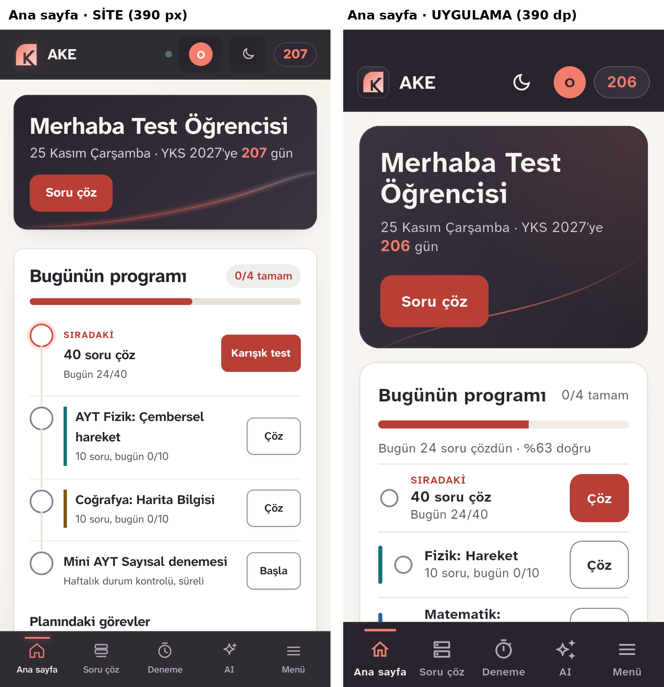 |
| Soru Merkezi | 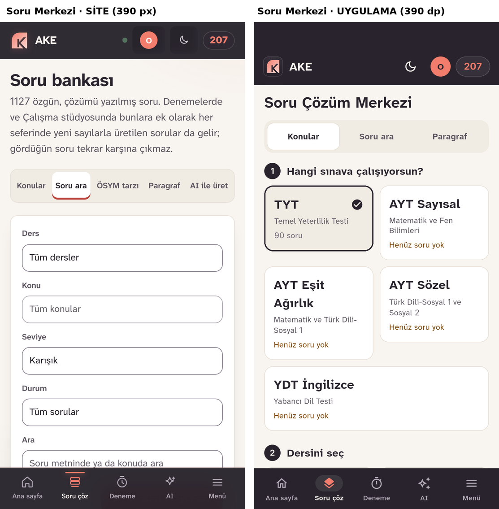 |
| Deneme (başlangıç) | 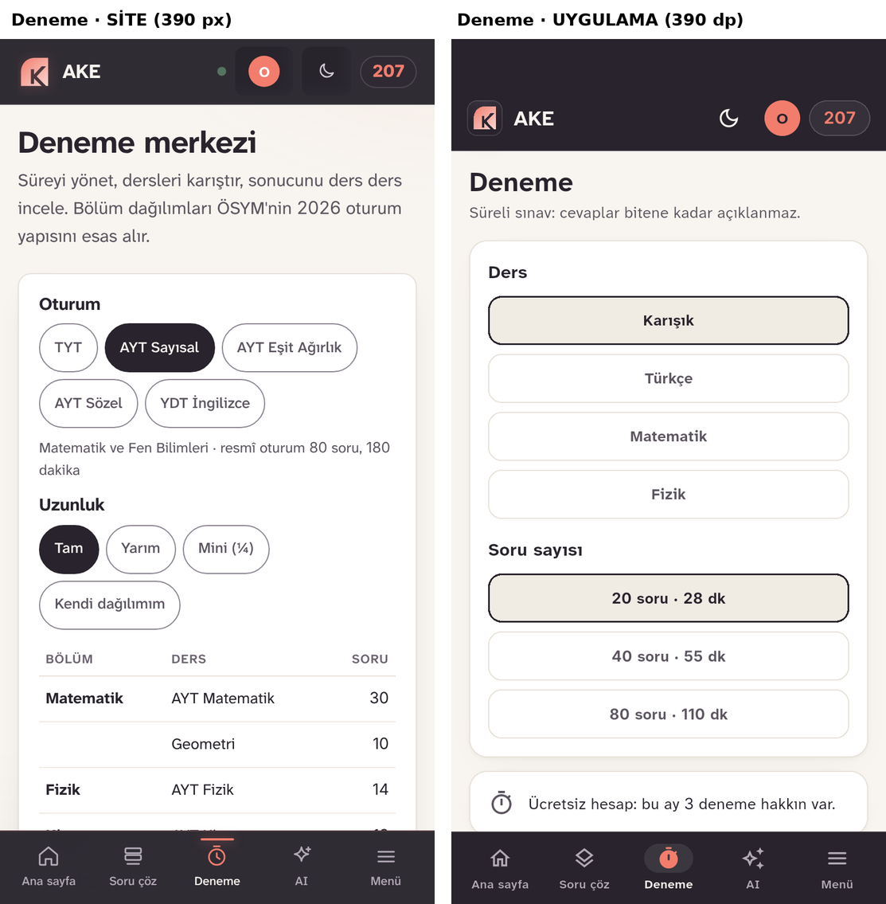 |
| AI (henüz mesaj yok) | 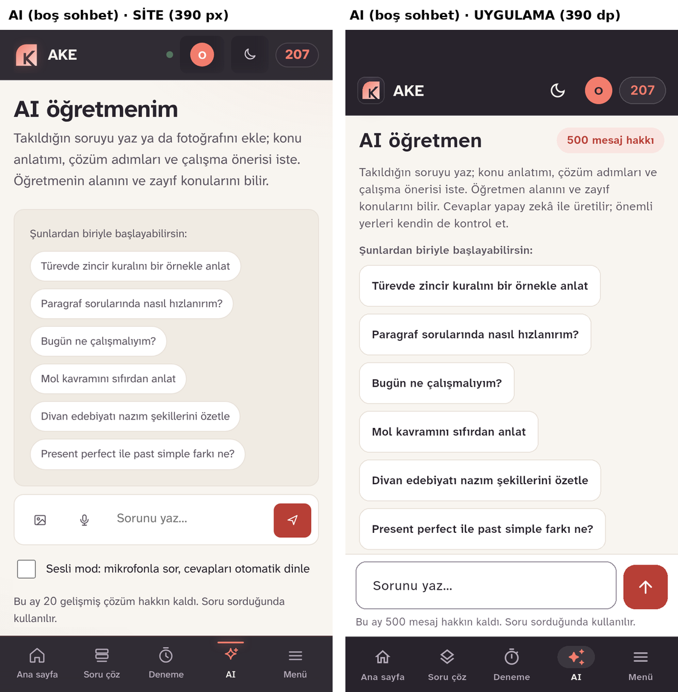 |
| Plan | 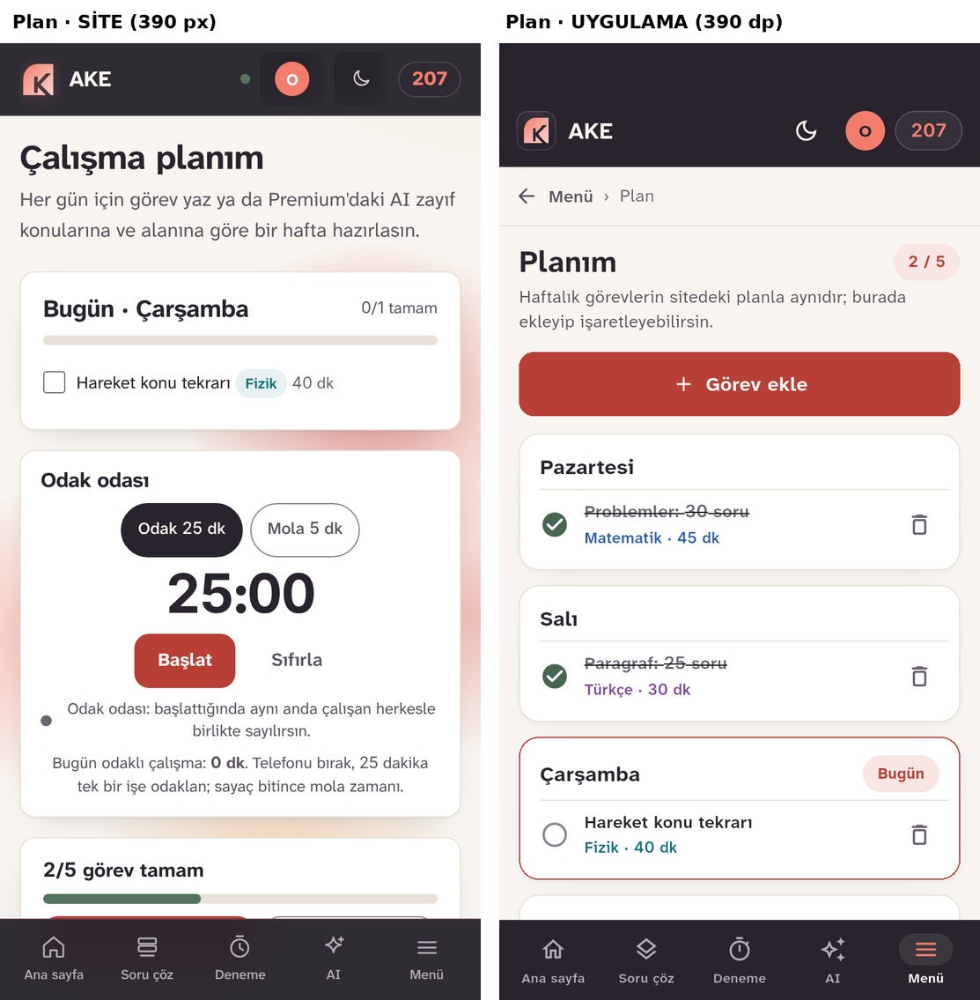 |
| Gelişim | 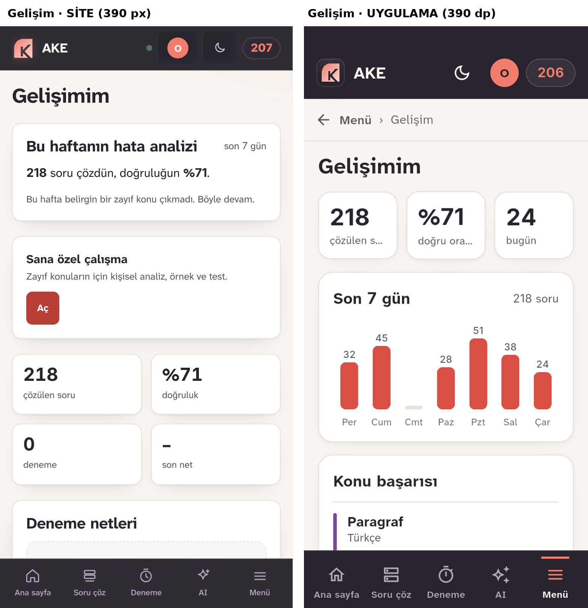 |

Ham site görüntüleri: `mobil-gorsel/site/`. Ham uygulama görüntüleri (açık/koyu): `mobil-gorsel/uygulama/`.

### Bu turda bulunup düzeltilen farklar
- **Veri biçimi uyuşmazlığı (işlev hatası):** site `profile` ve `plan` belgelerini iç içe saklar (`{_u, plan:{tasks}}`); uygulama düz okuyup yazıyordu. Sitede girilen plan uygulamada görünmez, uygulamadan yazılan site tarafından okunmazdı. Uygulama artık sitenin biçimini okur/yazar (testli; düz belge profil/plan sayılmaz).
- **Gelişim rakamları:** site "çözülen soru/doğruluk"u günlük sayaçlardan hesaplar, uygulama konulardan hesaplıyordu (146 ↔ 218). Uygulama da günlükten hesaplıyor; görüntüde 218 / %71 / bugün 24 birebir aynı.
- **AI:** boş sohbet açıklaması, sitedeki 6 başlangıç sorusu (kompakt hap düğmeler; önce tam genişlikte kutulardı) ve kota notu eklendi.
- **Deneme:** başlangıçta "Bu denemede" özeti (ders, soru, süre, net kuralı) ve **Son denemelerin** listesi (web + mobil `exams`); "Gelişim'e yazılmaz" notu kaldırıldı çünkü artık yazılıyor.
- **Üst çubuk:** sitedeki gibi tema düğmesi; **Ana sayfa** selamı sitedeki gibi tam ad.
- **Plan** görüntüsü sitede olduğu gibi yalnız 5 test görevi varken alınır (görev ekleme ayrı görüntü: `64-plan-gorev-eklendi`).

### Kalan, bilinçli farklar (siteye göre)
| Alan | Fark |
|---|---|
| Düzen | Uygulama mobil sekme düzenidir; piksel kopyası değil. Plan haftalık gün listesidir (sitede "Bugün" + Odak odası). |
| Deneme | Oturum (TYT/AYT…), uzunluk ve bölüm tablosu var; bölümlü oturumu sunucu kurar. Canlı deneme yok. |
| Soru Merkezi | Sitedeki "ÖSYM tarzı" ve "AI ile üret" sekmeleri yok (sunucuda karşılığı yok; düğme konmadı). |
| AI | Fotoğraf ekleme ve sesli mod yok. Soru metinleri: sitede kendi statik soru bankası; uygulamada sahte sunucunun 2 örnek sorusu (kullanıcı verisi aynı, soru içeriği aynı değil). |
| Plan | Odak odası var (Odak/Mola, Başlat·Duraklat·Sıfırla). Görev düzenleme ve Bugün listesi sitedeki gibi değil, haftalık gün listesi. |
| Simgeler | Material simgeleri; sitenin özel simge seti taşınmadı. K amblemi, renkler ve yazı tipi siteyle aynı kaynaktan. |
| Durum çubuğu | Emülatör görüntülerinde sistem durum çubuğu yakalanmıyor (üst şerit boş). |

## 2) Uygulama ekranları (Android emülatörü, 390 dp)
Tüm açık/koyu görüntüler `mobil-gorsel/uygulama/` içindedir (giriş → ana → Soru çöz → soru → Soru ara → Deneme → AI → Menü → Gelişim → Plan → Ayarlar → hesap silme onayı).

## 3) iOS simülatörü (iPhone 17 Pro, 402 pt) — çalıştırıldı
Aynı ekran yürüyüşü (giriş, alt gezinme, ana, Soru çöz, soru çözme, Deneme, AI, Gelişim, Plan, Ayarlar, hesap silme onayı) macOS CI'da simülatörde `flutter drive` ile çalıştı ve geçti (yalnız derleme değil). Açık tema görüntüleri: `mobil-gorsel/ios/`. Örnekler:

| Giriş | Ana | Soru okuma | Deneme sonuç | AI | Gelişim |
|---|---|---|---|---|---|
| 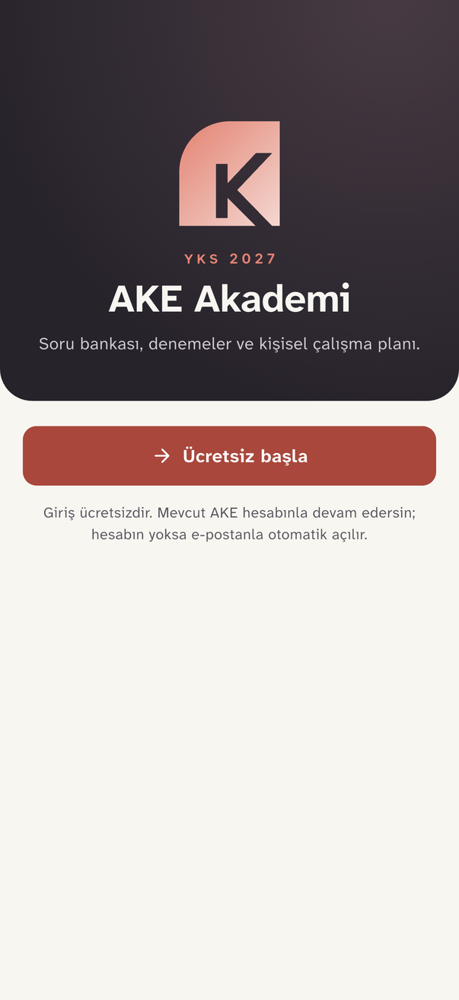 | 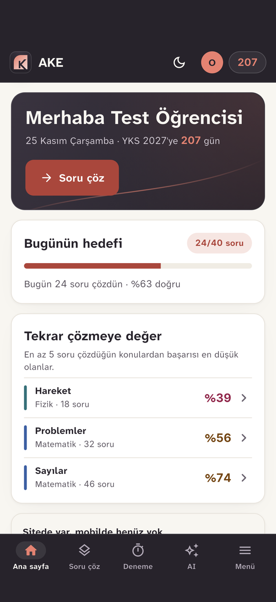 | 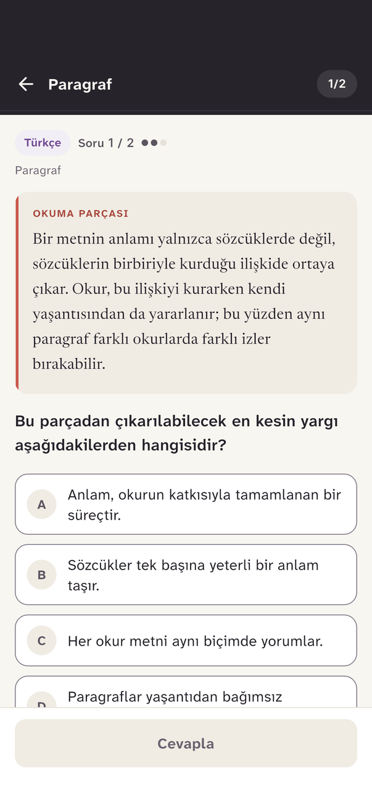 | 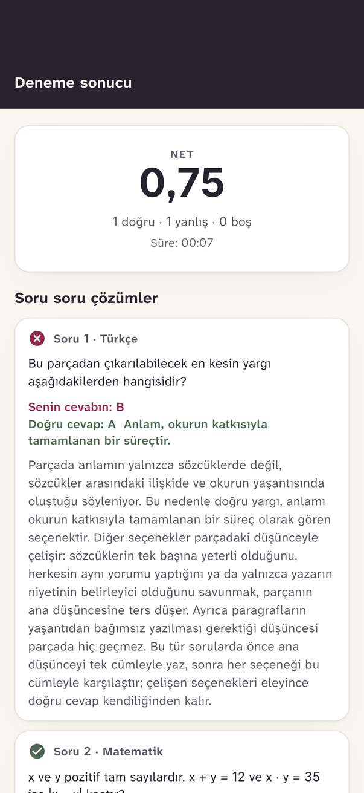 | 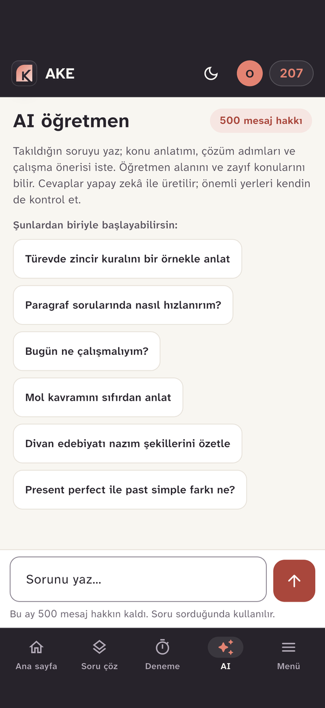 | 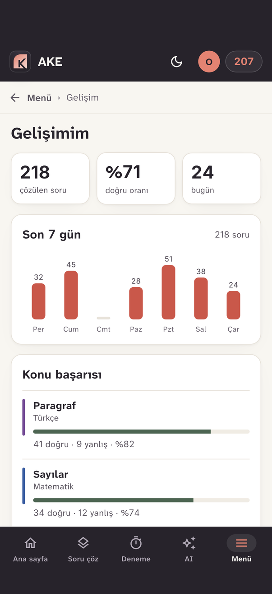 |

Sınırlar: simülatördür (gerçek iPhone değil); veri sahte sunucudur; imzasız derleme, TestFlight/mağaza yok; iOS'ta açılış süresi ölçülmedi.

## 4) Açılış animasyonu
- Tasarım süresi **2,45 sn → 2,15 sn** (1,9 sn animasyon + 0,25 sn sönme; birim testi ≤2,5 sn). Son kare gerçek K amblemi; "Geç" ilk kareden itibaren var; ikinci açılışta oynamaz; "hareketi azalt" açıkken 0 ms (CI'da doğrulandı: `neden=hareket_azalt sure_ms=0`).
- Kare başına yeniden üretilen nesneler (başlangıç noktaları, amblem yolu, yazı düzeni, gradyan gölgelendiricileri) önbelleğe alındı.
- **CI emülatöründe ölçülen gerçek süre (açılış başlangıcından bitişe):**

| Sürüm | 320 dp | 390 dp |
|---|---|---|
| Önce (2,45 sn tasarım) | 3354 ms, 15 kare, ort. 385 ms/kare | 3471 ms, 12 kare, ort. 598 ms/kare |
| Sonra (2,15 sn tasarım) | **2834 ms**, 14 kare, ort. 561 ms/kare | **3180 ms**, 6 kare, ort. 864 ms/kare |

- **Cihaz sınırı:** kare başına ortalama **hazırlama (UI) 1,3–3,6 ms**, **çizim (raster) 282–518 ms**. Yani uygulama kodu kare başına birkaç ms harcıyor; süreyi emülatörün yazılım GPU'su (SwiftShader) uzatıyor: animasyon zamana bağlı olduğundan, çok yavaş bir kare bitişi o karenin süresi kadar geciktirir (0,5–1,4 sn). **2,5 sn hedefi bu emülatörde tutmadı** (2,8–3,2 sn); tasarım süresi tutuyor (2,15 sn). Gerçek telefondaki akıcılık bu ölçümle kanıtlanmış DEĞİLDİR. Koşular arası değişim büyük (paylaşılan CI makinesi): "önce/sonra" farkı kesin kanıt değil, yönü gösterir.
