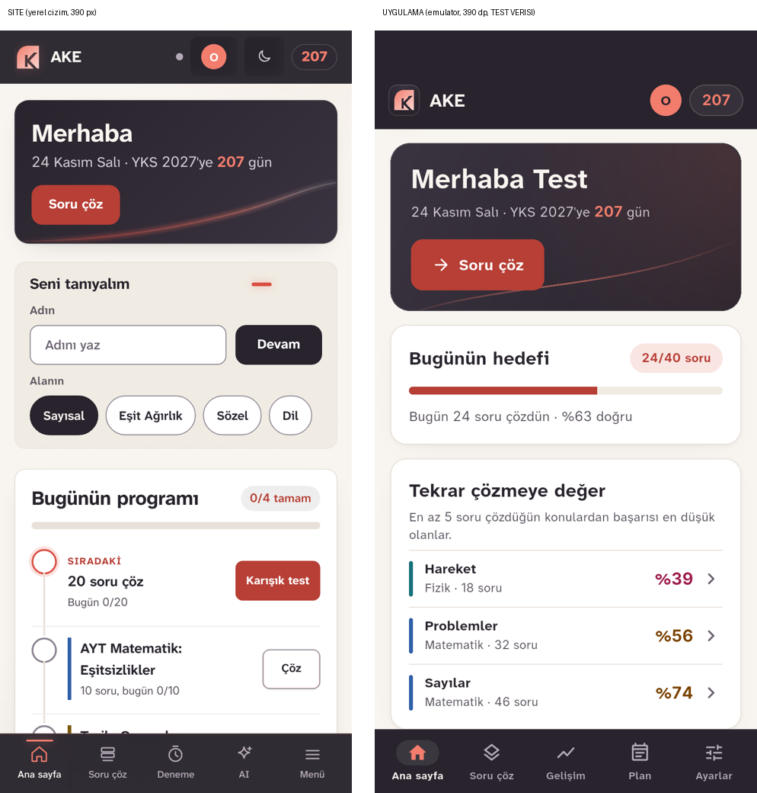
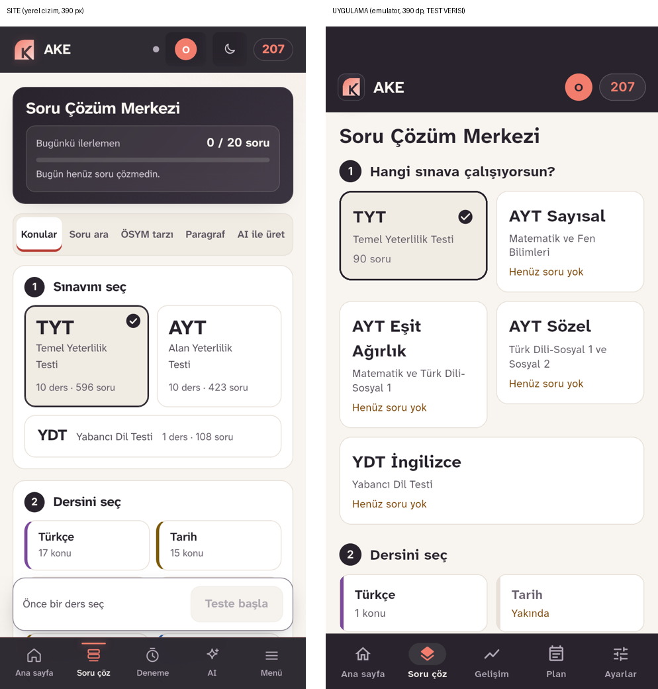
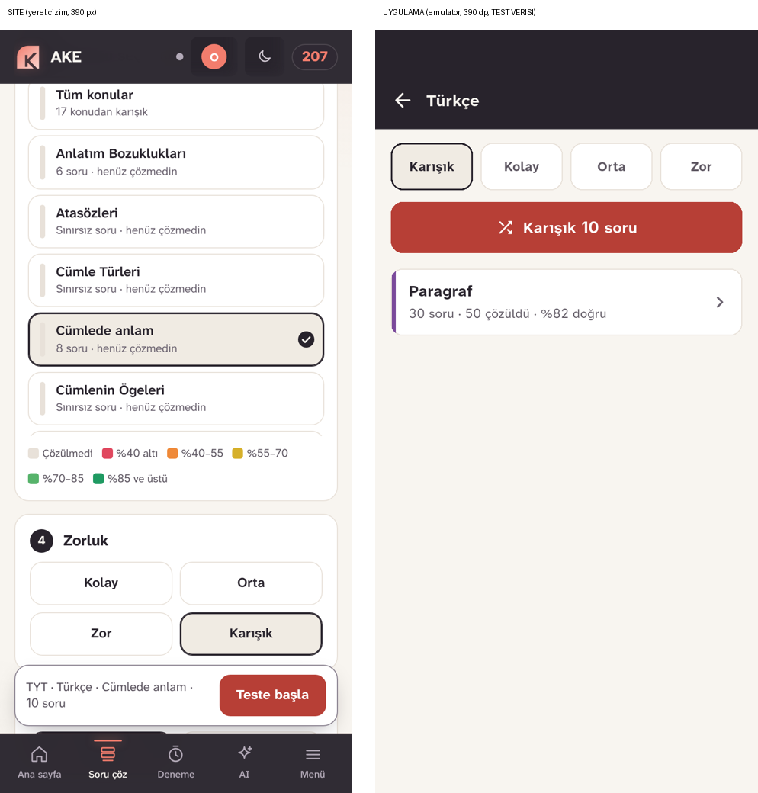
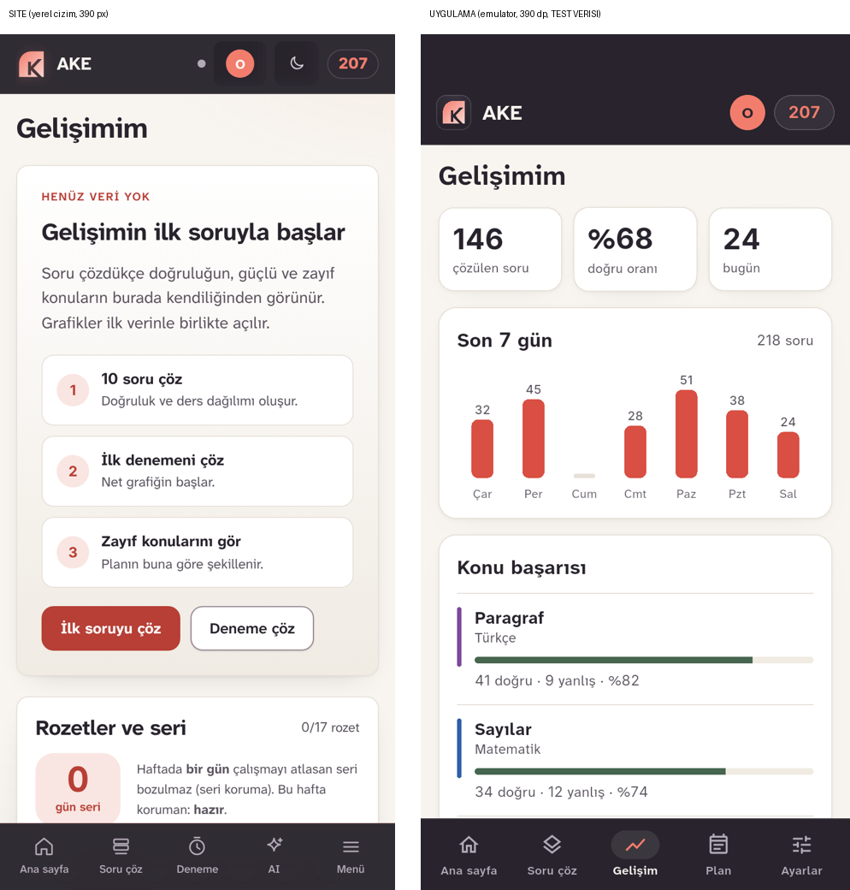
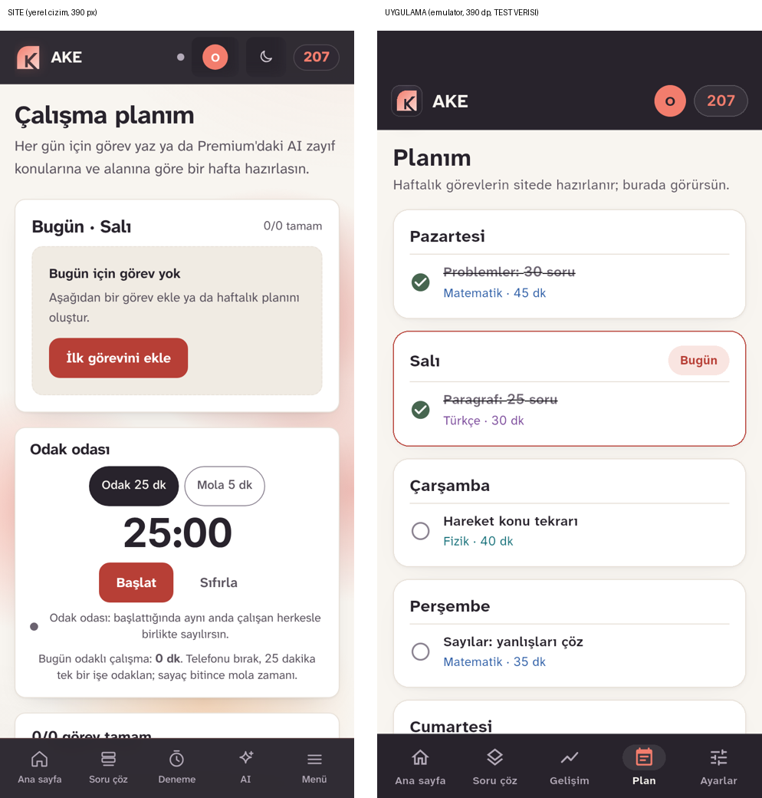
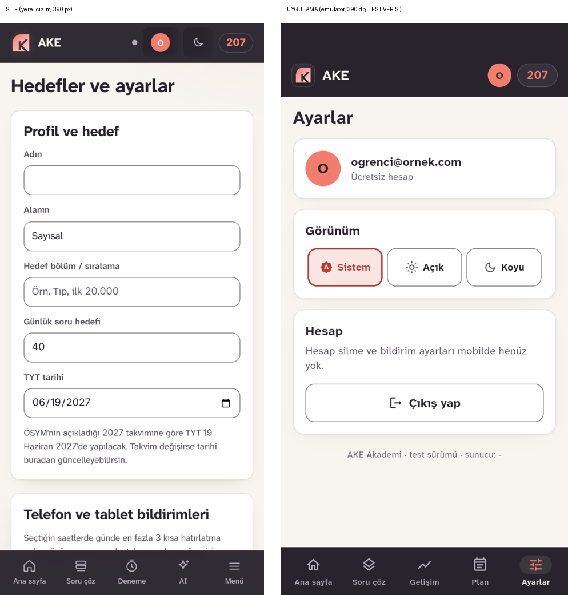
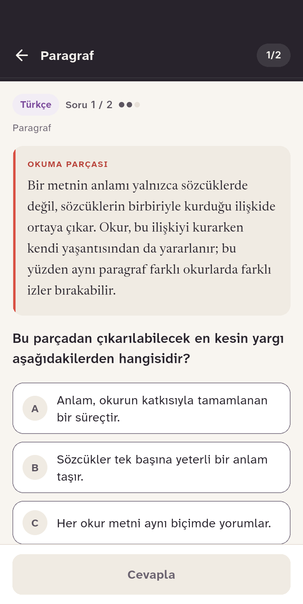
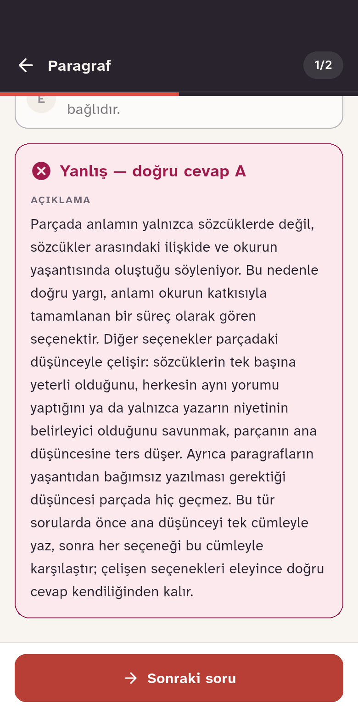
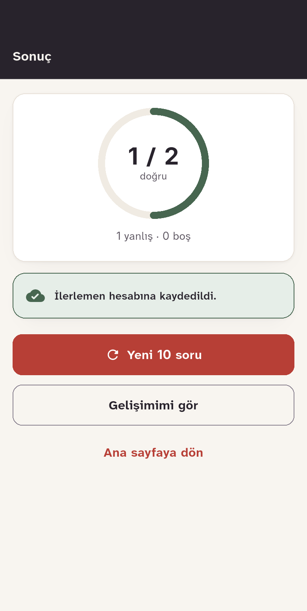
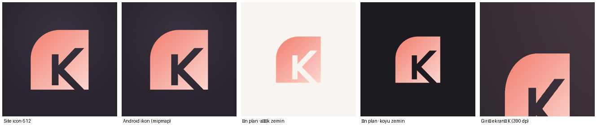

# Mobil uygulama – site görsel karşılaştırması

Soldaki: sitenin 390 px yerel çizimi (API sahte yanıtlarla; canlı hesap yok). Sağdaki: Android emülatör, 390 dp, **TEST VERİSİ** (sahte sunucu; gerçek giriş yapılmadı). Kanıt dalı: `kanit/pr43-6918d4a`.

| Ekran | Site referansı | Yeni uygulama | Kalan fark |
|---|---|---|---|
| Ana sayfa |  | aynı görsel | Sitede "Seni tanıyalım" ve program listesi var; uygulamada hedef + tekrar listesi. Alt menü: sitede Deneme/AI/Menü, uygulamada Gelişim/Plan/Ayarlar. Gece/gündüz düğmesi üst çubukta değil, Ayarlar'da. |
| Soru Çözüm Merkezi |  | aynı görsel | Sitede "Soru ara / ÖSYM tarzı / Paragraf / AI ile üret" sekmeleri var, uygulamada yok. |
| Konu + zorluk |  | aynı görsel | Zorluk seçici ve sol renk şeritli kartlar aynı dilde; sitede konu listesi tek sayfada, uygulamada adım adım. |
| Gelişim |  | aynı görsel | Site referansı **boş durum** (veri yok); uygulama görüntüsü test verisiyle dolu. Aynı veriyle site karşılaştırması yapılmadı. |
| Plan |  | aynı görsel | Sitede odak odası ve plan düzenleme var; uygulamada yalnız haftalık görünüm (salt okunur). |
| Ayarlar |  | aynı görsel | Sitede profil/hedef/bildirim düzenleme var; uygulamada tema + çıkış. |

Soru çözme ekranı için **site referansı alınamadı** (yerel çizimde oturum bağlantısı kurulamadı). Yalnız uygulama:
  

K amblemi / ikon: 

## Açılış animasyonu (emülatör, gerçek zamanlı kayıt)
- 390 dp ilk açılış: 3,45 s; 320 dp: 3,22 s (hedef ≤2,5 s **tutmadı** emülatörde). Kare süresi ort. 380–723 ms: CI emülatörü yazılım GPU'su kullanıyor, **telefondaki akıcılık kanıtlanmadı**.
- İkinci açılışta animasyon oynamadı; "Geç" ilk kareden görünür; 320 dp "hareketi azalt" açıkken animasyon 0 ms (atlandı) — emülatörde doğrulandı.
- Son kare gerçek K amblemi + giriş ekranı.

## Açık sınırlar
iOS derlenmedi/denenmedi (macOS/Xcode yok). Simgeler Material (sitenin simge seti değil). Deneme, AI öğretmen, plan düzenleme, hesap silme, profil/hedef, bildirim, lig/Sınıfım, paketler/ödeme mobilde yok (uygulamada "Sitede var, mobilde henüz yok" olarak görünür). Ödeme bu turda yok; mağaza faturalaması sonra (sandbox + 20/B hazırlığı).
